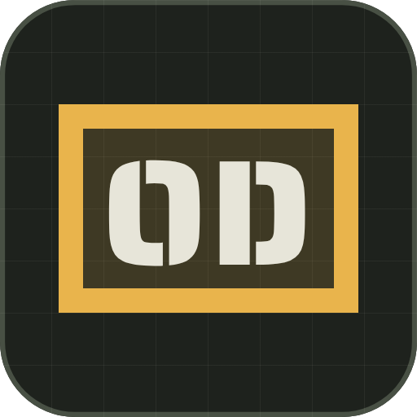
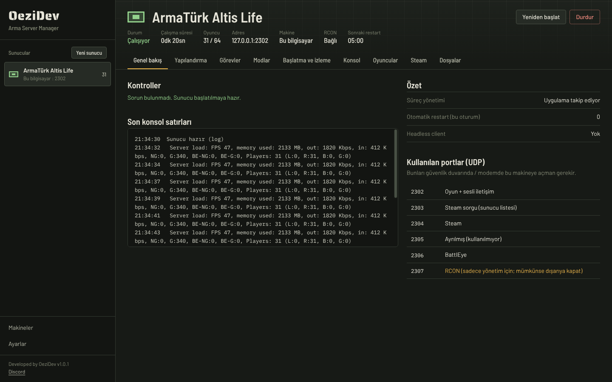
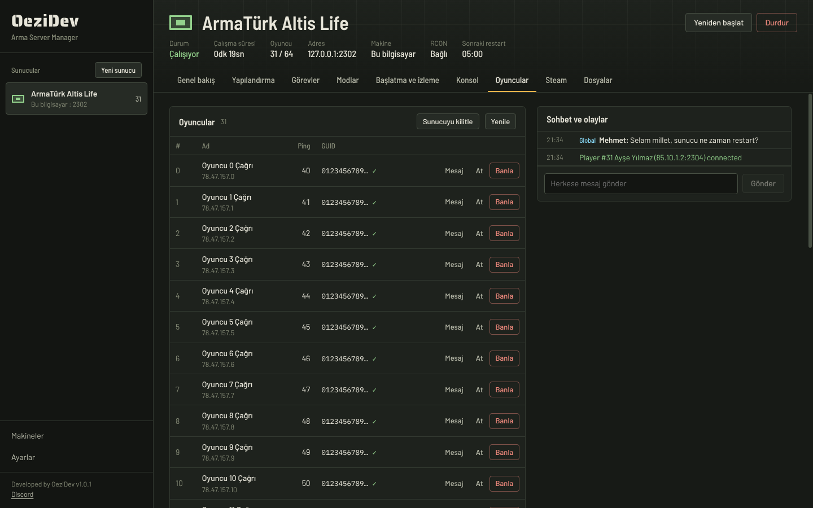
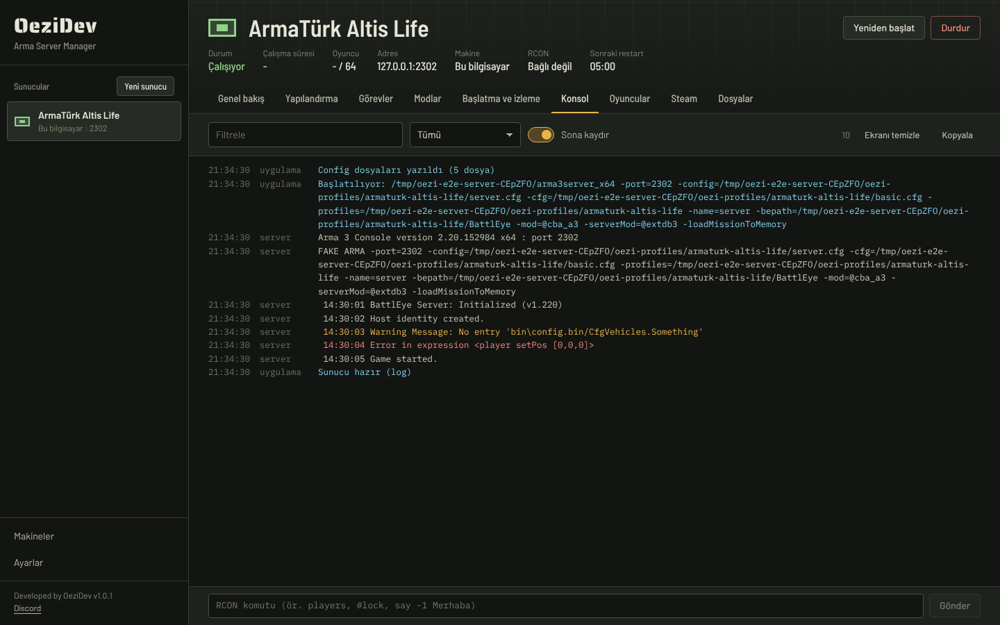
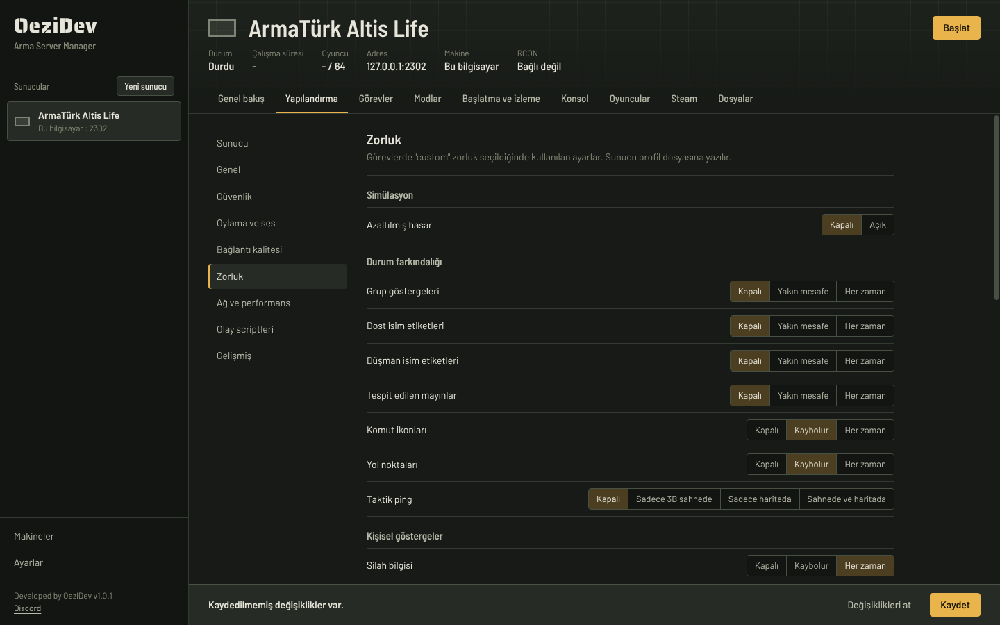
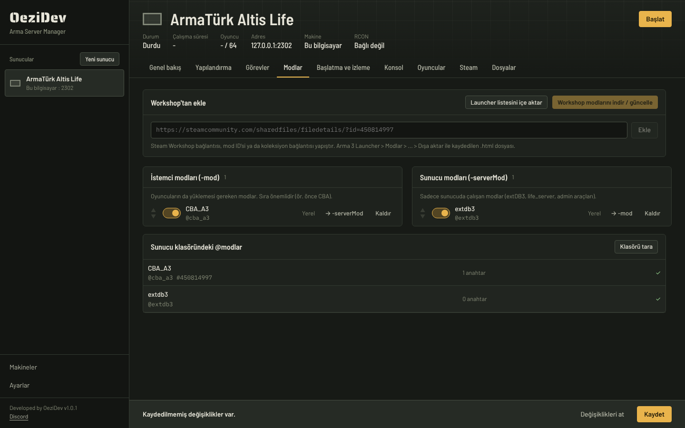
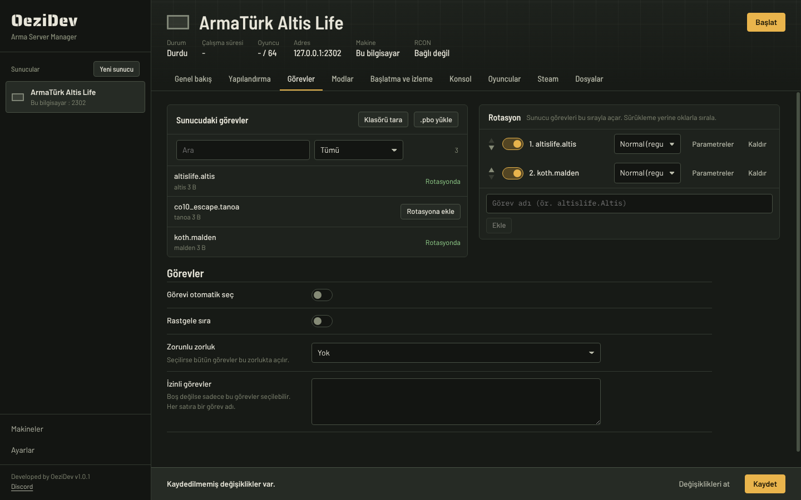
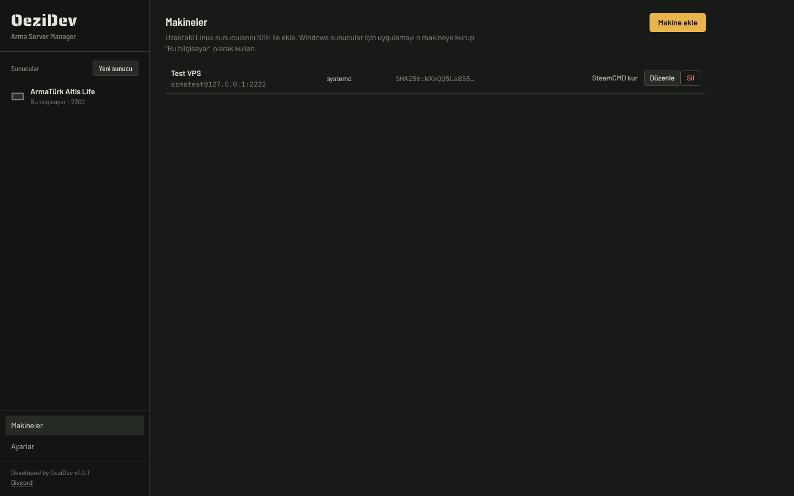

<div align="center">



# OeziDev Arma Server Manager

Arma 3 dedicated sunucularını tek yerden kurmak, yapılandırmak, başlatmak ve izlemek için masaüstü uygulaması.<br>
Windows'ta çalışır; aynı uygulamadan hem bu bilgisayardaki sunucuları hem de SSH ile uzaktaki Linux VPS sunucularını yönetir.

[](https://github.com/OeziDev/oezi-arma-server-manager/releases/latest)


[](https://discord.gg/JNnkdBN5GP)

**[⬇ İndir (Windows kurulum)](https://github.com/OeziDev/oezi-arma-server-manager/releases/latest)**



</div>

## Ekran görüntüleri

<table>
  <tr>
    <td width="50%"><br><sub><b>Oyuncular ve RCON</b>: ping, GUID, mesaj, kick, ban, sohbet akışı</sub></td>
    <td width="50%"><br><sub><b>Canlı konsol</b>: RPT / journald, filtre, uyarı ve hata renklendirme, RCON komutları</sub></td>
  </tr>
  <tr>
    <td><br><sub><b>Yapılandırma</b>: server.cfg, basic.cfg ve zorluk ayarları Arma 3'ün gerçek değerleriyle</sub></td>
    <td><br><sub><b>Workshop modları</b>: bağlantı, koleksiyon ya da Launcher listesiyle ekle, tek tuşla indir</sub></td>
  </tr>
  <tr>
    <td><br><sub><b>Görev rotasyonu</b>: MPMissions taraması, .pbo yükleme, zorluk ve parametreler</sub></td>
    <td><br><sub><b>Uzak Linux VPS</b>: SSH ile bağlan, sunucu systemd servisi olarak çalışsın</sub></td>
  </tr>
</table>

## Özellikler

**Yapılandırma**
- server.cfg, basic.cfg, Arma3Profile (zorluk) ve BattlEye cfg'yi tek profilden üretir. Tırnaklar doğru kaçırılır, sayılar her dilde nokta ile yazılır.
- Zorluk ayarları Arma 3'ün gerçek değerleriyle: 0/1/2 (kapalı / yakında / her zaman, 3. şahıs "sadece araç" dahil).
- `kickClientsOnSlowNetwork[]`, `kickTimeout[]`, `admins[]`, `AdvancedOptions`, görev parametreleri (`class Params`), izinli görev listesi.
- Arayüzde olmayan her şey için "ek satırlar": yazarken sözdizimi kontrol edilir, bozuk config sunucuya gitmez.
- Mevcut server.cfg (TADST dahil) ve Arma3Profile içe aktarma. Tanınmayan satırlar kaybolmaz.
- Canlı kontroller: zayıf şifre, port çakışması, `-autoInit` için `persistent`, Linux'ta büyük harfli mod/görev adı gibi hatalar.

**Sunucu yönetimi**
- Başlat / durdur / yeniden başlat. Durdururken önce RCON ile `#shutdown` gönderilir (Altis Life verisi kaydedilsin), sonra süreç kapatılır.
- Çökünce otomatik yeniden başlatma; bir saatte en fazla N kez (döngüye girmez). Discord bildirimi.
- Linux VPS'te sunucu bir **systemd servisi** olur: uygulama kapalıyken de çöken sunucu yeniden başlar, VPS yeniden başlayınca sunucu da açılır. Loglar journald'dan okunur.
- Headless client'lar: sayısını gir, sunucuyla birlikte başlar ve durur.
- Zamanlı restart: günlük saatler, oyunculara RCON ile geri sayım mesajları, istenirse restart sırasında SteamCMD ile güncelleme.
- Uygulama yeniden açılınca çalışan sunucuları bulur ve takibe devam eder. Aynı exe ile çalışan başka profillerin süreçleri karıştırılmaz.

**Konsol ve RCON**
- Canlı log (Windows'ta RPT, Linux'ta journald), filtre, hata/uyarı renklendirme, RCON komut satırı.
- Oyuncu listesi (ping, GUID), mesaj, kick, ban, ban listesi, GUID/IP ile ban, sunucu kilitleme, sohbet ve giriş/çıkış akışı.

**Steam**
- SteamCMD ile sunucu kurulum/güncelleme (public, creatordlc, profiling, contact dalları).
- Steam Guard: kod istenirse uygulama sorar; giriş bir kez yapılınca SteamCMD hatırlar.
- Workshop: bağlantı, ID, **koleksiyon** veya Arma 3 Launcher'dan dışa aktarılmış mod listesi (.html) ile ekleme; tek tuşla indir/güncelle, zaman aşımında yeniden deneme, `@mod` bağlantısı, `.bikey` anahtarlarının `keys/` klasörüne kopyalanması (mod kaldırılınca sadece ona ait anahtar silinir), Linux için küçük harfe çevirme.

**Güvenlik**
- Şifreler Windows hesabına bağlı olarak şifrelenir (DPAPI / Electron safeStorage); profil dışa aktarmada şifreler yer almaz.
- SSH sunucu parmak izi ilk bağlantıda kaydedilir; değişirse bağlanmaz.
- Komutlar argüman dizisi olarak çalıştırılır, kabuk birleştirmesi yoktur (boşluklu yollar, tırnaklar güvenli).

## Kurulum (Windows)

[Releases](https://github.com/OeziDev/oezi-arma-server-manager/releases) sayfasından `OeziDev-Arma-Server-Manager-Setup-<sürüm>.exe` dosyasını indirip çalıştır.
Uygulama imzalı olmadığı için Windows SmartScreen "Bilinmeyen yayıncı" uyarısı verebilir: **Ek bilgi → Yine de çalıştır**.

**Otomatik güncelleme:** kurulu sürüm açılışta ve 6 saatte bir GitHub Releases'ı kontrol eder, yeni sürümü arka planda indirir ve
"Yeniden başlat ve güncelle" der (Ayarlar → Güncellemeler). Güncelleme sırasında sadece uygulama yeniden başlar; çalışan Arma sunucuları kapanmaz.
Portable exe otomatik güncellenmez; verilerini exe'nin yanındaki `OeziArmaManager-data` klasöründe tutar.

## İlk adımlar

1. **Ayarlar → Steam**: Arma 3 sahibi bir Steam hesabının kullanıcı adı/şifresi ve SteamCMD yolu (yoksa "SteamCMD indir ve kur").
2. Linux VPS kullanıyorsan **Makineler → Makine ekle**: adres, kullanıcı (root veya sudo yetkili), şifre ya da SSH anahtarı. "Bağlantıyı test et" parmak izini gösterir; kaydet. Aynı ekrandan VPS'e SteamCMD kurabilirsin.
3. **Yeni sunucu**: makineyi ve sunucu klasörünü seç; eski bir server.cfg'n varsa içe aktar.
4. **Steam** sekmesi: sunucuyu kur/güncelle. **Modlar** sekmesi: Workshop modlarını ekle ve "indir / güncelle".
5. **Görevler**: MPMissions klasörünü tara veya .pbo yükle, rotasyona ekle.
6. **Başlat.** Konsol ve Oyuncular sekmelerinden canlı takip et.

Varsayılan portlar (UDP): oyun 2302, Steam 2303-2304, BattlEye 2306, RCON 2307 (oyun portu + 5). Genel bakış sekmesi açılması gereken portları listeler. RCON portunu mümkünse internete kapat.

## Bilinmesi gerekenler

- Windows sunucuları SSH ile **uzaktan** yönetilmez: uygulamayı o Windows makineye kurup "Bu bilgisayar" olarak kullan. Uzak yönetim Linux içindir.
- Zamanlı restart ve Windows'taki otomatik yeniden başlatma uygulama açıkken çalışır (pencereyi kapatınca tepside kalır). Linux'ta çökme sonrası yeniden başlatmayı systemd yapar, uygulama kapalı olsa bile.
- Linux'ta Arma sunucusu mod ve görev adlarının küçük harf olmasını ister; Workshop modları otomatik çevrilir.
- Linux'ta sunucu "steamclient.so" hatasıyla açılmıyorsa Steam sekmesindeki "steamclient.so düzelt" butonunu kullan.

## Geliştirme

```bash
npm install
npm test                                   # çekirdek testleri (config, RCON, SSH, süreç yöneticisi, SteamCMD)
npm run build -w packages/app              # arayüz + ana süreç
npm start -w packages/app                  # uygulamayı çalıştır
npm run dist:win -w packages/app           # Windows kurulum + portable exe (Linux'ta Wine gerekir)
# Yeni sürüm: packages/app/package.json'daki "version"ı artır, main'e pushla → GitHub Actions derleyip Release'e koyar,
# kurulu uygulamalar kendini günceller
xvfb-run -a env E2E=1 npx vitest run packages/app/test/e2e.test.ts   # uçtan uca arayüz testi
```

SSH ve systemd testleri `127.0.0.1:2222` adresinde bir test sshd'si bulursa çalışır, yoksa atlanır.

### Yapı

```
packages/core   Saf TypeScript çekirdek (Electron'dan bağımsız; web paneline de takılabilir)
  config/       Arma config yazıcı/okuyucu, dosya üreticileri, içe aktarma
  model/        Profil şeması (zod) ve sabitler
  launch/       Yollar ve komut satırı (Windows / POSIX / systemd tırnaklama)
  host/         Yerel makine ve SSH (dosya, süreç, systemd, log takibi)
  rcon/         BattlEye RCon istemcisi ve çıktı ayrıştırıcıları
  supervisor/   Süreç yöneticisi ve zamanlayıcı
  steam/        SteamCMD ve Workshop
packages/app    Electron uygulaması
  src/main      Ana süreç: veri deposu, şifreli anahtarlar, IPC
  src/preload   Arayüze açılan güvenli köprü
  src/renderer  React arayüzü (Türkçe / English)
```

## Lisans

Copyright © 2026 OeziDev. Tüm hakları saklıdır. Bu proje TADST'den kod içermez; sıfırdan yazılmıştır.
Kullanılan açık kaynak bileşenlerin lisansları `packages/app/build/licenses/` klasöründe ve uygulamanın `resources/licenses` klasöründedir
(Electron, React, ssh2, zod: MIT; Barlow, Saira Stencil One, IBM Plex Mono yazı tipleri: SIL Open Font License 1.1).
